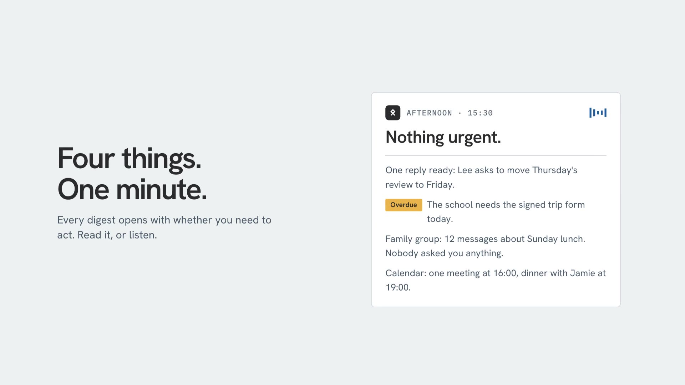
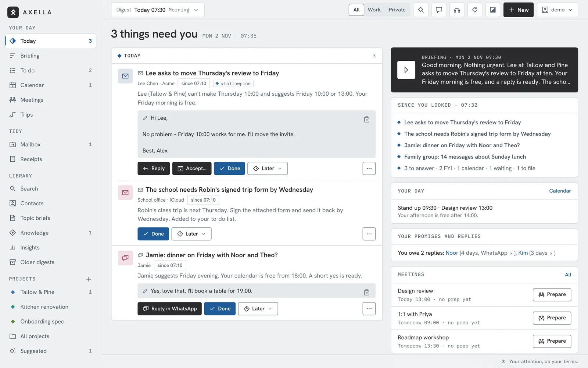
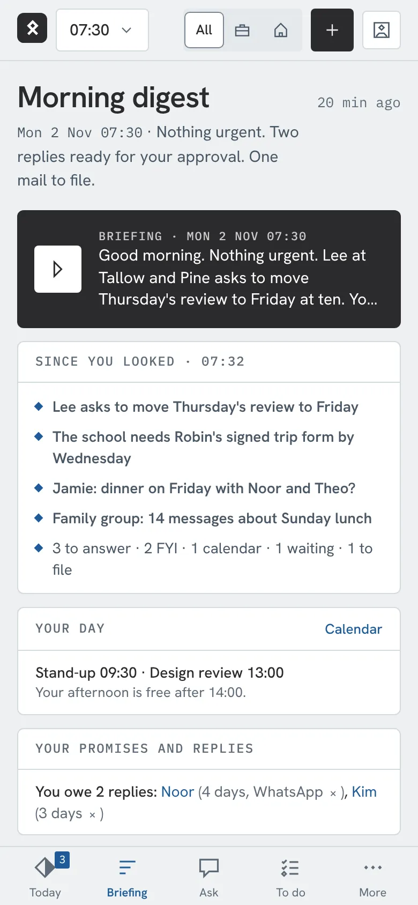
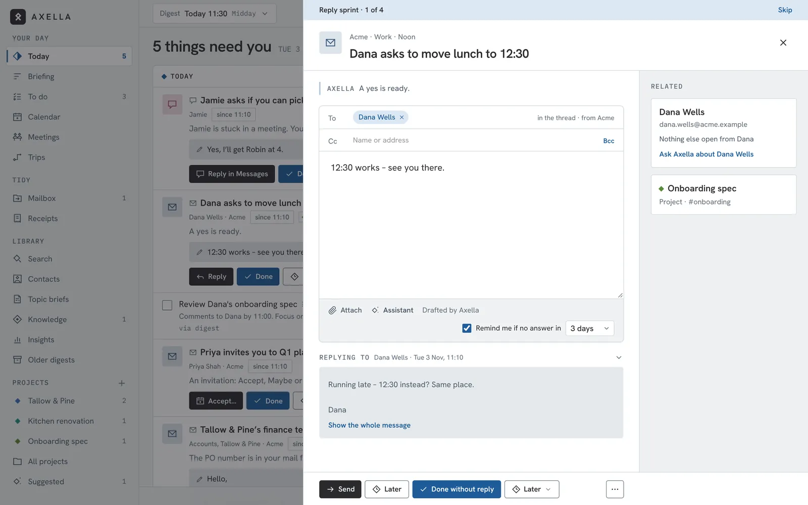
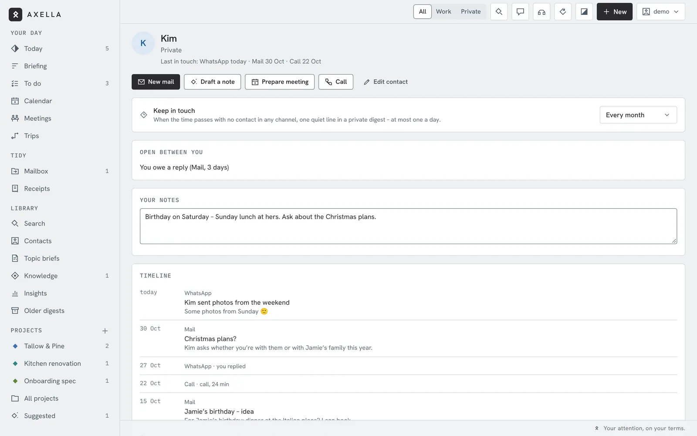
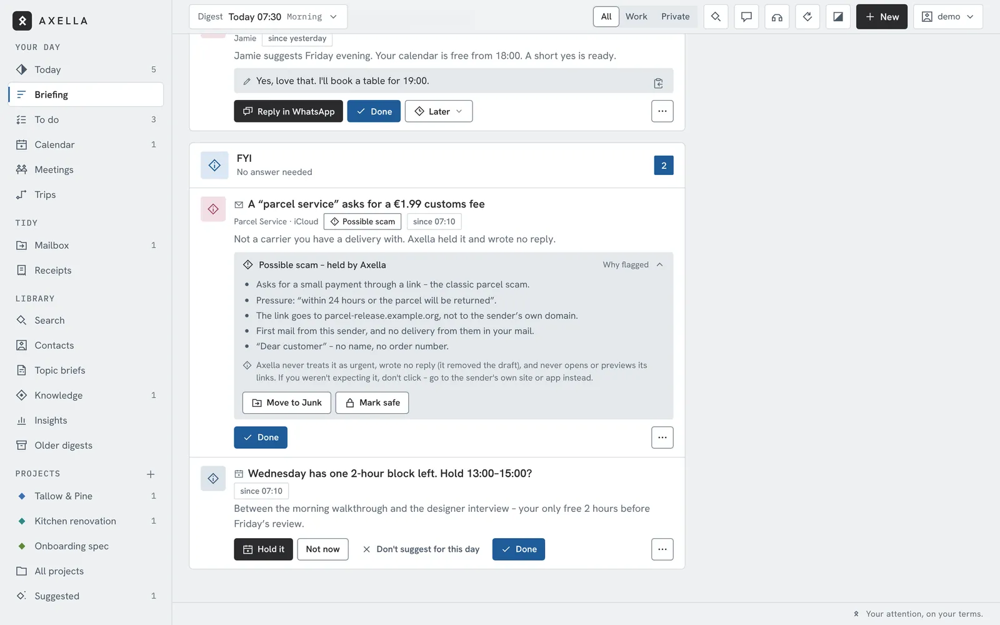
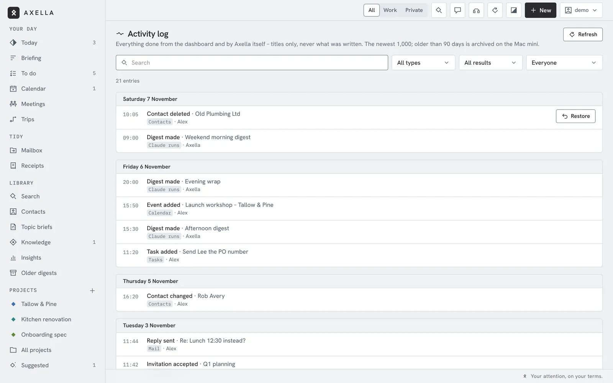

<p align="center">
  
</p>

<h1 align="center">Axella</h1>

<p align="center"><strong>Your attention, on your terms.</strong></p>

<p align="center">
  A personal message assistant that gathers email, iMessage/SMS, WhatsApp, Signal, calls and calendar into one calm place,<br>
  and tells you what matters when <em>you</em> choose to listen. Hosted in your home, on a Mac you own.
</p>

<p align="center">
  <a href="https://axella.dev">axella.dev</a> ·
  <a href="https://axella.dev/try/">Try the demo</a> ·
  <a href="https://axella.dev/features.html">All features</a> ·
  <a href="docs/SETUP.md">Setup guide</a> ·
  <a href="docs/ARCHITECTURE.md">How it's built</a> ·
  <a href="docs/ROADMAP.md">Roadmap</a> ·
  <a href="https://axella.dev/#feedback">Feedback</a>
</p>

<p align="center">
  
  
  
</p>

---

> *Afternoon · 15:30*
> **Nothing urgent.** One reply ready for your approval. Work is quiet. Dinner at 19:00.

That is an Axella digest. Instead of five apps pinging you all day, one assistant listens on your behalf, holds the
noise, and hands you a short digest at the times you pick – spoken or read. The first sentence always answers the
only question that matters: *do I need to do anything?*

<p align="center">
  <a href="https://axella.dev/#demo"></a><br>
  <sub>▶ Watch the 90-second demo on <a href="https://axella.dev/#demo">axella.dev</a></sub>
</p>

## What it does

| | |
|---|---|
| **1 · It listens everywhere** | Email accounts, iMessage and SMS, WhatsApp, Signal (optional), calls and calendar – read on your own machine, so you don't have to keep checking. |
| **2 · It holds the noise** | Nothing pings. New messages wait for your next digest; only what's urgent by *your* VIP list and rules breaks through. Every item is tagged work or private, so you can look at one world at a time. |
| **3 · It tells you when you choose** | Morning briefing, midday update, afternoon check, evening wrap – or your own rhythm. Short, spoken or read, and it often starts with *"Nothing urgent."* |
| **4 · It drafts. You decide.** | Replies are prepared in your tone and wait for you. Approve, edit or discard. **Nothing is sent without your tap.** |

## Inside Axella

The real dashboard, shown with made-up data. It follows your light or dark setting.
Want to click around? **[Try the demo](https://axella.dev/try/)** – the real app in your browser, with an example week.

<picture>
  <source media="(prefers-color-scheme: dark)" srcset="docs/images/today-dark.webp">
  
</picture>

<table>
  <tr>
    <td width="33%" valign="top">
      <picture>
        <source media="(prefers-color-scheme: dark)" srcset="docs/images/phone-dark.webp">
        
      </picture>
      <br><b>On your phone.</b> A Home Screen app with push. Listen to the digest, swipe to handle items.
    </td>
    <td width="67%" valign="top">
      <picture>
        <source media="(prefers-color-scheme: dark)" srcset="docs/images/reply-sprint-dark.webp">
        
      </picture>
      <br><b>Reply sprint.</b> Quick replies one after another – each Send is its own tap.
    </td>
  </tr>
  <tr>
    <td colspan="2">
      <table>
        <tr>
          <td width="33%" valign="top">
            <picture>
              <source media="(prefers-color-scheme: dark)" srcset="docs/images/people-dark.webp">
              
            </picture>
            <br><b>People.</b> One page per person – what's open, your notes, and a nudge to keep in touch.
          </td>
          <td width="33%" valign="top">
            <picture>
              <source media="(prefers-color-scheme: dark)" srcset="docs/images/scam-check-dark.webp">
              
            </picture>
            <br><b>Scam check.</b> Suspicious mail is held and explained, not shown as a task.
          </td>
          <td width="33%" valign="top">
            <picture>
              <source media="(prefers-color-scheme: dark)" srcset="docs/images/activity-dark.webp">
              
            </picture>
            <br><b>Activity log.</b> Everything Axella and you did, with Restore where it can be undone.
          </td>
        </tr>
      </table>
    </td>
  </tr>
</table>

## More than a digest

Around the digests, Axella moves things forward – and everything that acts waits for your tap.
All 53 features, each shown in an example day, are on **[axella.dev/features](https://axella.dev/features.html)**.

- **Your day** – digests on your rhythm, Today with what needs you now, work and private kept apart, listen on the go, the week wrap, and only what's urgent by your rules breaks through.
- **Reply and send** – replies with To, Cc and Bcc and a few seconds to undo, a writing assistant (improve, tone, spelling, translate), a reply sprint for quick answers, send later, new mail in your own tone, and Accept, Maybe or Decline on invitations.
- **Follow through** – the promises you made and the replies you owe, who you're waiting on, to-dos with dates, bills and renewals (insurance, subscriptions, the passport).
- **Meetings and calendar** – calendar with invitees and online meetings (Teams, Meet, Zoom, iCloud), meeting prep from the calendar or a mail, after the meeting: recording or transcript, outcomes and a follow-up mail, and protect your free blocks.
- **People** – contacts, a page per person with keep in touch and birthdays, and private contacts whose messages never reach Claude.
- **Keep order** – filing suggestions you tick, receipts and spend, subscriptions, trips put in order from your booking mails, newsletters one tap from gone, projects and mail for a project.
- **Know more** – Ask Axella (answers with sources), search across Axella and all your mail, topic briefs, a knowledge base your drafts may use, insights and calm in numbers.
- **While you're away** – an optional call agent that takes a message, out of office per mailbox, holidays and days off, and one calm Welcome back digest after two days or more.
- **Trust and control** – an activity log with Restore, a scam check, *What leaves my home*, system status with an always-on watchdog, Report a problem with a privacy render, and an encrypted backup to move to a new Mac.

## Why Axella

AI inbox assistants are arriving as cloud services. To summarise and draft, they need a copy of your whole
communication life on someone else's servers. Axella makes the opposite choice.

- **She lives in your home.** Axella runs on a Mac mini on your shelf – a machine you own and can unplug.
- **100% your data.** Messages, digests, drafts, history and settings are stored only on that machine. There is no Axella account and no Axella server. Backups are encrypted with a passphrase that is never stored.
- **You stay in charge.** Axella prepares; you decide. Mail is only sent when you tap Send and confirm (with a few seconds to undo), or at the time you scheduled with that tap – never by a Claude run on its own. No permanent delete anywhere in the code – "delete" means Trash.
- **You can see what she did.** The activity log lists every action, and *What leaves my home* shows exactly what goes to Claude and the optional call agent.
- **Private network only.** The dashboard is reachable only inside your own Tailscale network. No open ports.
- **Honest about the AI.** The reading and writing is done by Claude, through *your own* Claude subscription. That is the one outside service in the loop – plus the call agent and meeting services, if you switch them on.

## How it's built

```
 Mail · Messages · WhatsApp · Signal · Calendar · Contacts      (on the Mac mini)
        │  read-only, via the macuse MCP server and local exporters
        ▼
 Claude Code runs on a schedule  ──▶  digests (Markdown + JSON) · drafts · suggestions
        │
 Action service (Python, localhost) ── job queue · send queue · Web Push · receipts · trips · knowledge · reminders
        │
 Web server + watchdog (LaunchDaemons, always on)
        │
 Dashboard (React 19 + Vite + Tailwind)  ──▶  Tailscale Serve  ──▶  your iPhone and laptop
```

- **Mac mini** (any always-on Mac, macOS 15+) runs everything; the web server and a watchdog start at boot.
- **Claude Code** on your Claude Pro/Max subscription does the reading, prioritising and drafting, with a read-only tool allow-list.
- **[macuse](https://macuse.app)** lets Claude read Mail, Calendar, Contacts and Messages.
- **Tailscale** gives you HTTPS to the dashboard from your devices, and nobody else – connections are accepted only from Tailscale's own process.
- **Optional:** the call agent ([`axella-voice`](https://github.com/AccelathonDK/axella-voice): Twilio + a small Vercel app + Claude Haiku), Signal (receive only), and meeting services for online invites.

Full details in [docs/ARCHITECTURE.md](docs/ARCHITECTURE.md).

## Get started

Axella is free. You need an always-on Mac, a Claude subscription, macuse, Tailscale and about an hour.

```bash
mkdir -p ~/dev/own/home-server && cd ~/dev/own/home-server
git clone https://github.com/AccelathonDK/axella.git axella
```

Then follow the **[setup guide](docs/SETUP.md)** (also at [axella.dev/setup](https://axella.dev/setup)): permissions,
your own rules (`AXELLA.md`), contacts and VIPs, the background services, Tailscale, the dashboard, the iPhone
app, and the optional extras (call agent, Signal, meeting services, backups). Everything personal lives in files that are never committed – the repo only ships examples
(`AXELLA.example.md`, `contacts.example.md`, `setup/actions-config.example.json`).

Working on the code? See [docs/DEVELOPMENT.md](docs/DEVELOPMENT.md) and [CLAUDE.md](CLAUDE.md).

## Status

Axella is young: it is used every day by its author and now shared so others can try it, adapt it and improve it.
Expect rough edges, and macOS only for now. What's next – more sources such as Slack and Teams chat, simpler
setup, household modes – is in the [roadmap](docs/ROADMAP.md).

## Feedback and contributing

Ideas, bugs and questions are very welcome – open an [issue](https://github.com/AccelathonDK/axella/issues) or use the
form on [axella.dev](https://axella.dev/#feedback). Pull requests are welcome too; please keep the hard rules in
[CLAUDE.md](CLAUDE.md) (nothing is ever sent automatically, servers bind to localhost only, no personal data in git).

## License

[MIT](LICENSE) © 2026 Morten Toft

<sub>Built by Morten Toft – developer, dad, entrepreneur – after years of living with the "New message" notification.
[LinkedIn](https://www.linkedin.com/in/morten-toft-7a138648/)</sub>
